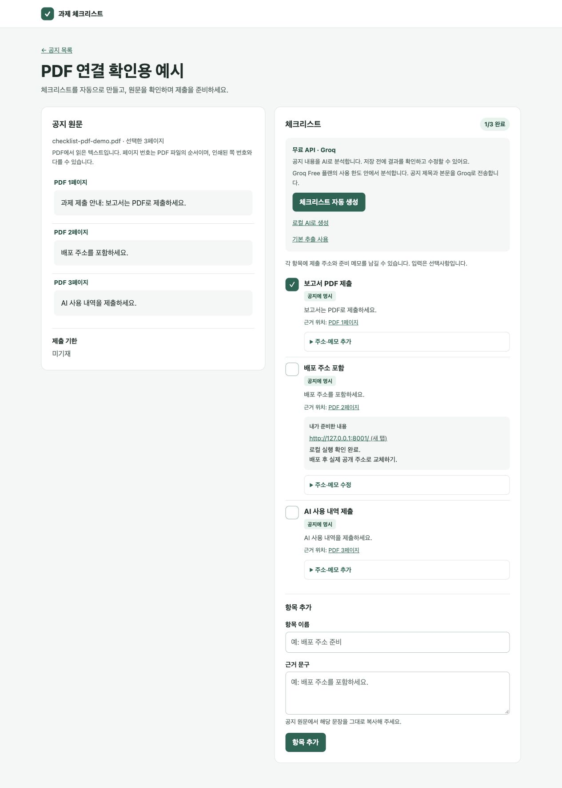

# 과제 제출 누락 방지 도우미 개발 문서

작성 기준일: 2026년 11월 12일

문서 버전: 2.0

구현 기준: `00554e8`

저장소: [notory678/assignment-checklist](https://github.com/notory678/assignment-checklist)

이 문서는 한국어 과제 공지에서 제출·준비 항목을 정리하는 웹앱의 현재 구현과 운영 방법을 설명한다. 공지 등록, AI 추출과 사용자 검토, PDF 페이지 근거, 완료 체크, 제출 주소·준비 메모 저장까지 구현되어 있다. 제출 전 최종 점검 전용 화면과 외부 클라우드 배포는 다음 개발 범위다.

코드와 실제 구현 과정의 검증 결과를 기준으로 작성했다. 문서의 예시 조건은 기능 설명용이며 특정 과목의 실제 제출 조건을 대신하지 않는다.


### 평가 항목과 문서 위치

| 개발 문서 평가 항목 | 비중 | 이 문서에서 확인할 부분 |
|---|---|---|
| 문제와 사용자와 시나리오 | 15% | 1장 문제 설정과 세 가지 사용 상황 |
| 요구사항과 완료 기준 | 20% | 2장 우선순위와 확인 가능한 완료 기준 |
| 프로그램 설계 | 20% | 5~10장 구성요소·데이터·정상 및 실패 흐름 |
| 피드백과 자기 점검의 변경 기록 | 15% | 3장 변경 전후와 판단 이유 |
| 테스트를 통한 개선 기록 | 20% | 12장 조건별 기대·실제 결과와 수정·재시험 |
| 실행 및 사용 안내 | 10% | 4장 사용 순서와 11장 처음 실행 절차 |

## 1 프로젝트 목적과 차별화

과제 공지에 흩어져 있는 보고서 형식, 배포 주소, 시연 조건, AI 사용 기록 등을 작업 항목으로 정리해 제출 준비를 돕는다. 사용자는 공지의 원문과 추출 결과를 비교한 뒤 필요한 항목을 선택하고 준비 내용과 완료 상태를 저장한다.

이 프로젝트는 일반적인 할 일 목록에 세 가지 기능을 결합한다.

- **요구사항의 원문 근거:** 각 필수 항목에 공지의 실제 문구를 표시한다. PDF에서는 해당 문구가 있는 페이지도 연결한다.
- **명시 조건과 제안의 구분:** 공지에 명시된 작업과 AI·규칙이 제안한 추가 준비 작업을 구분한다. 제안 항목은 기본으로 선택하지 않는다.
- **준비 결과의 보관:** 완료 체크와 함께 제출 주소, 파일 위치, 시연 순서 같은 사용자 메모를 항목별로 보관한다.

마감일이 원문에 없으면 검토 화면과 검토 저장 후 상세 화면에 ‘미기재’로 표시한다. 연도나 날짜를 계산해 보완하지 않는다. 아직 추출을 검토하지 않은 공지는 ‘자동 추출 후 확인할 수 있습니다’로 안내한다.


### 누구의 어떤 문제를 해결하는가

주사용자는 보고서, 서비스 주소, 시연을 한꺼번에 준비하는 대학생이다. 공지에는 할 일뿐 아니라 예시, 선택 사항, 추후 안내가 함께 적혀 있다. 내용을 일반 할 일 앱에 옮기는 동안 제출 조건을 빠뜨리거나 권장 사항을 필수로 받아들일 여지가 있다. 제출물을 준비했어도 파일 위치와 주소가 다른 곳에 흩어져 있으면 마지막 확인이 번거롭다.

이 프로젝트에서는 공지 원문에서 조건을 꺼내고 그 근거를 남기는 데 범위를 맞췄다. 교수자의 요구와 사용자의 준비 기록을 함께 보되 둘을 구분해 읽을 수 있도록 했다. 아래 시나리오는 기능을 확인하기 위한 예시이며 사용자 조사 통계나 실제 누락률을 뜻하지 않는다.

### 시나리오 S1 공지를 처음 읽었을 때

보고서 PDF, 배포 주소, 정상·실패 시연, AI 사용 내역을 요구하는 공지를 등록한다. 기본 추출로 명시 항목 4개를 찾고 원문 근거를 비교한다. 추가 준비 제안은 기본 선택에서 빠져 있어야 한다. 사용자가 필수 항목만 저장하면 체크리스트에는 4개가 남는다. 기한이 공지에 없으면 ‘미기재’로 확인한다.

### 시나리오 S2 강의 PDF에 과제 안내가 섞여 있을 때

텍스트가 있는 PDF를 올려 페이지별 미리보기를 연다. 과제 조건이 있는 페이지만 골라 저장하고 체크리스트를 만든다. 근거 옆의 페이지 번호를 누르면 해당 번호의 추출 텍스트로 이동해야 한다. 페이지 번호의 기준은 선택 전 PDF다. 텍스트를 읽지 못한 페이지는 경고를 보고 원본을 따로 확인한다.

### 시나리오 S3 제출 직전에 준비한 내용을 다시 찾을 때

완료한 항목을 체크하고 배포 주소와 시연 순서를 저장한다. 공지 목록으로 돌아갔다가 다시 열어도 완료 상태와 메모가 남아 있어야 한다. 주소·메모가 있다고 완료 체크가 자동으로 바뀌지는 않는다. 제출 전 최종 점검 전용 화면은 다음 개발 범위로 두고 현재는 상세 화면에서 내용을 확인한다.

## 2 현재 구현 범위

| 기능 | 상태 | 현재 동작 |
|---|---|---|
| 공지 등록과 재조회 | 완료 | 제목·본문을 저장하고 목록·상세 화면에서 조회 |
| 자동 체크리스트 추출 | 완료 | Groq, 로컬 Ollama, 기본 규칙 중 선택 |
| 추출 결과 검토 | 완료 | 이름·근거 수정, 항목 선택·제외, 선택 항목 저장 |
| 원문 근거와 기한 표시 | 완료 | 실제 원문 일치 검증, 확인되지 않은 기한은 미기재 |
| 체크리스트 직접 추가 | 완료 | 항목 이름과 공지에서 복사한 근거를 입력 |
| 완료 상태 저장 | 완료 | 항목별 완료·해제와 전체 완료 개수 표시 |
| PDF 공지 등록 | 완료 | 페이지별 본문 미리보기, 필요한 페이지 선택·저장 |
| PDF 근거 페이지 연결 | 완료 | 원문 일치 위치에서 페이지 번호 계산·이동 |
| 제출 주소와 준비 메모 | 완료 | 항목별 저장·수정·비우기, 저장 주소 열기 |
| GitHub 버전 관리 | 완료 | 현재 구현 코드가 main 브랜치에 반영됨 |
| 제출 전 최종 점검 화면 | 예정 | 필수 항목 진행률·남은 작업·준비 내용을 통합 |
| 계정별 접근 분리와 클라우드 배포 | 예정 | 현재는 개인 로컬 사용 범위 |
| 스캔 PDF OCR과 바탕화면 전용 표시 | 미구현 | 현재 제공 범위에 포함하지 않음 |


### 우선순위와 완료 기준

제출 범위를 정리하면서 P0는 핵심 사용 흐름, P1은 입력과 준비 기록을 보완하는 기능으로 구분했다. 아래 항목은 모두 현재 구현한 범위다. P2 확장 후보는 표 아래에 별도로 적었다. 완료 여부는 화면에 버튼이 있다는 사실보다 저장 결과와 오류 처리까지 확인하는 기준으로 판단했다.

| ID와 기능 | 우선순위 | 충족 여부를 확인하는 완료 기준 | 확인 근거 |
|---|---|---|---|
| R01 공지 등록 | P0 | 제목·본문 저장 후 목록과 상세에서 재조회한다. 공백뿐인 입력은 거절한다. | API와 HTTP 검사 |
| R02 기본 추출 | P0 | S1의 명시 조건 4개를 원문 근거와 함께 찾고 추가 제안은 기본 선택에서 제외한다. | TC01과 TC02 |
| R03 근거와 기한 | P0 | 원문에 없는 근거는 저장하지 않는다. 기한이 없으면 날짜를 만들지 않는다. | TC02와 TC03 |
| R04 검토 저장 | P0 | 수정·선택한 후보만 한 번에 저장한다. 반복·동시 저장으로 중복을 만들지 않는다. | TC03과 TC04 |
| R05 완료 상태 | P0 | 완료·해제 후 재조회해도 상태가 유지되고 주소·메모는 바뀌지 않는다. | TC08 |
| R06 오류 안내 | P0 | 키·응답·한도 오류를 안내한다. 다른 AI 서비스로 자동 전환하지 않는다. | TC10 |
| R07 AI 연결 | P1 | Groq와 로컬 Ollama가 같은 출력 구조를 따르고 유효한 근거만 검토 후보에 남긴다. | AI 통합 검사 3개 |
| R08 PDF 입력 | P1 | 5MB·50페이지 이내의 텍스트 PDF를 미리 보고 선택 저장한다. 상한 초과와 텍스트 없음은 안내한다. | TC05와 TC06 |
| R09 PDF 근거 | P1 | 선택 전 페이지 번호를 유지한다. 인용을 고쳐 저장하면 새 근거의 페이지를 계산한다. | PDF 단위·통합 검사 |
| R10 주소와 메모 | P1 | 주소 2,048자·메모 4,000자 이내에서 저장·수정·비우기와 재조회가 된다. 잘못된 값은 기존 내용을 바꾸지 않는다. | TC07과 TC08 |
| R11 저장 자료 보호 | P0 | 다른 공지의 항목 변경은 거절한다. 재추출 시 기존 준비 내용과 완료 상태를 보존한다. | TC04와 TC09 |
| R12 직접 추가 | P1 | 공지에서 그대로 복사한 근거로 항목을 추가하고 같은 상세 화면에서 확인한다. | 저장 경로와 사용 화면 |

P2에는 제출 전 최종 점검 화면, 계정별 접근 분리와 클라우드 배포, 스캔 PDF OCR, 원문 구절 강조, 바탕화면 전용 표시를 두었다. 현재 제출 범위의 완료 조건에는 포함하지 않았다.

## 3 피드백과 자기 점검으로 바꾼 내용

변경 근거는 개발 대화에서 나온 요청과 구현 중 직접 확인한 문제다. 외부 사용자 인터뷰나 교수자의 개별 피드백을 받은 것처럼 적지 않았다. 날짜를 추정하는 대신 변경 순서와 확인 가능한 커밋을 함께 남겼다.

### C1 일반 할 일 목록에서 공지 근거 확인으로

초기 논의에서는 과제용 할 일 앱이 시중의 도구와 어떻게 달라야 하는지가 문제였다. 이에 항목을 뽑는 기능에 원문 근거와 명시·제안 구분을 붙였다. 이 판단에 따라 사용자가 추출 결과를 바로 저장하지 않고 먼저 수정·선택하게 했다. 근거가 틀린 후보를 저장 전에 거를 수 있어야 한다고 보았다. 관련 구현은 `5baf07c`에 남아 있다.

### C2 무료 사용 요청에 맞춘 AI 연결 변경

Hugging Face 호스팅 API를 연결했을 때 실제 요청에서 HTTP 402를 확인했다. 무료로 진행하고 싶다는 요청을 반영해 Groq를 기본 경로로 바꾸고 Mac의 로컬 Ollama와 기본 규칙을 선택지로 남겼다. 오픈소스 모델과 무료 호스팅 API를 같은 조건으로 보면 안 된다는 점도 확인했다. 요청 실패 때 다른 서비스로 자동 전환하면 사용자가 비용과 전송 대상을 알기 어려워 수동 선택을 유지했다. 관련 커밋은 `cbeea0e`다.

### C3 PDF를 본문 입력 흐름에 연결

PDF에서도 체크리스트를 만들고 싶다는 요청을 반영했다. 강의 자료 전체를 바로 AI에 보내기보다 먼저 텍스트를 읽고 필요한 페이지를 고르게 했다. 읽힌 내용을 확인하고 입력 길이를 줄일 수 있기 때문이다. 페이지 번호는 AI가 만든 값을 믿지 않고 서버에서 실제 인용 위치로 계산하도록 했다. 이 변경은 `0693b5f`에서 확인할 수 있다.

### C4 완료 체크에 준비 결과 저장 추가

완료 표시만으로는 실제 배포 주소나 시연 순서를 다시 찾기 어려웠다. 이를 보완하려고 항목별 주소·메모를 저장하고 ‘내가 준비한 내용’으로 표시했다. 공지 원문 근거와 사용자 기록은 다른 정보이므로 화면과 저장 필드를 나눴다. 재추출로 같은 항목이 제외되어도 이 기록을 보존하는 조건을 검사했다. 관련 커밋은 `00554e8`다.

### C5 이번 평가 기준을 반영한 문서 수정

기존 문서는 기능과 코드 구조를 설명하는 데 치우쳐 있었다. 이번 수정에서는 사용자를 정하고 시나리오 S1~S3, 요구사항 R01~R12, 테스트 조건 TC01~TC10을 붙였다. 테스트 개수만 제시하던 부분에는 기대 결과, 실제 결과, 수정 후 재시험을 추가했다. 구현하지 않은 최종 점검 화면과 배포는 확장 계획으로 남겼다.

## 4 사용 흐름과 화면

### 공지 본문으로 시작하기

1. 첫 화면에서 공지 제목과 본문을 입력하고 **공지 저장**을 누른다.
2. 상세 화면에서 **체크리스트 자동 생성**을 누른다. 기본 설정은 Groq이며 키가 없으면 기본 규칙을 사용한다.
3. 추출 결과에서 원문과 비교하며 이름·근거를 수정하고 저장할 항목을 선택한다.
4. **선택한 항목 저장**을 눌러 체크리스트에 추가한다. 후보 생성만으로 기존 체크리스트가 바뀌지는 않는다.
5. 준비를 마치면 항목 왼쪽의 체크 버튼을 누른다. 다시 누르면 완료를 해제한다.
6. **주소·메모 추가**에서 준비한 내용을 적고 저장한다. 저장 후 **주소·메모 수정**으로 변경할 수 있다.

### PDF로 시작하기

첫 화면의 **PDF로 등록**에서 파일을 선택하고 **PDF 본문 미리보기**를 연다. 읽힌 텍스트를 원본과 비교한 뒤 과제 안내가 있는 페이지만 선택한다. 제목을 정하고 **선택한 페이지로 공지 저장**을 누르면 기존 상세 화면으로 이동한다. 이후의 추출·검토·저장 순서는 텍스트 공지와 같다.

PDF를 업로드하거나 공지로 저장하는 단계에서는 외부 AI를 호출하지 않는다. 사용자가 Groq 추출을 실행할 때 저장한 제목과 선택 본문을 전송한다.

### 화면 구성

| 화면 | 역할 | 주요 조작 |
|---|---|---|
| 공지 목록 | 공지 입력과 저장한 공지 탐색 | 공지 저장, PDF 미리보기, 상세 열기 |
| PDF 본문 확인 | 페이지별 텍스트와 경고 확인 | 페이지 선택·해제, 제목 지정, 공지 저장 |
| 공지 상세 | 원문과 저장한 체크리스트 확인 | 추출, 완료 체크, 직접 추가, 주소·메모 저장 |
| 추출 결과 확인 | 후보를 원문과 대조 | 이름·근거 수정, 선택·제외, 검토 저장 |

## 5 시스템 구조와 기술 구성

브라우저는 HTML 폼으로 FastAPI에 요청한다. 서버가 PostgreSQL에서 데이터를 읽고 Jinja2로 화면을 만든다. PDF 파싱과 AI 응답 검증도 서버에서 처리하며 브라우저에 API 키를 전달하지 않는다.

```text
브라우저
  └─ FastAPI와 Jinja2
       ├─ PostgreSQL 저장소
       ├─ pypdf 별도 프로세스
       └─ 추출 처리
            ├─ 기본 규칙
            ├─ Groq API
            └─ Mac에서 실행하는 Ollama
```

| 영역 | 사용 기술 | 역할 |
|---|---|---|
| 서버 | Python 3.13, FastAPI, Uvicorn | 요청 처리와 앱 실행 |
| 화면 | Jinja2, HTML, CSS, JavaScript | 서버 렌더링과 입력·선택 안내 |
| 데이터베이스 | PostgreSQL 16, psycopg | 공지·체크리스트·검토 자료 저장 |
| 입력·출력 검증 | Pydantic | 필드 길이, URL, 구조화 응답 검증 |
| PDF | pypdf | 텍스트를 페이지별로 읽기 |
| 기본 AI | Groq의 openai/gpt-oss-20b | 원문에서 구조화된 후보 생성 |
| 예비 AI | Ollama와 qwen3:4b | Mac에서 로컬 추론 |
| 실행·형상 관리 | Docker Compose, Git, GitHub | 앱·DB 실행과 버전 관리 |

### 주요 코드의 책임

| 경로 | 책임 |
|---|---|
| `main.py` | 앱 시작, DB 초기화, 업로드 크기 제한, JSON API |
| `web.py` | HTML 화면과 폼 요청, 추출·검토·저장 흐름 |
| `store.py` | 데이터 모델, 검증, PostgreSQL 조회·저장 |
| `extraction.py` | 기본 규칙, Groq·Ollama 요청, 근거·기한 검증 |
| `pdf_input.py` | PDF 검사·파싱과 근거 페이지 계산 |
| `db/init.sql` | 테이블·인덱스 생성과 기존 DB의 필드 추가 |
| `templates/`와 `static/` | 화면, PDF 원문 표시, 스타일, 선택 상태 안내 |
| `scripts/local_ai.py` | 프로젝트 내부 Ollama 설치·시작·종료·상태 확인 |
| `tests/` | 추출·PDF·DB·HTTP 흐름 검사 |


### 이 구조를 선택한 이유

현재 규모에서는 화면과 서버를 따로 개발하기보다 FastAPI가 Jinja2 화면까지 반환하는 구성이 단순했다. PDF 처리와 입력 검증을 Python에서 이어 쓸 수 있었고 복잡한 프런트엔드 상태를 추가하지 않아도 검토·저장 순서를 보여줄 수 있었다. 공지와 체크리스트는 다시 열어 확인해야 하므로 PostgreSQL에 저장했다.

AI 응답은 초안으로 다룬다. 외부 호출을 `extraction.py`에 모으고 저장을 `store.py`에서 처리해 모델을 바꿔도 검토와 DB 저장 흐름은 유지하도록 나눴다. PDF 파서는 별도 프로세스에 두고 시간·자원 상한을 적용했다. 복잡하거나 손상된 파일 하나 때문에 웹 요청이 오래 묶이는 경우를 줄이려고 이렇게 선택했다.

### 정상 실행과 실패 실행의 흐름

정상 흐름은 공지 저장 → 추출 요청 → 응답 구조·원문 검증 → 검토 자료 저장 → 사용자 선택 → 체크리스트 저장 순서다. 완료 체크와 주소·메모 갱신은 저장된 항목에만 적용한다. PDF는 이 흐름 앞에 텍스트 파싱과 페이지 선택을 추가한다.

실패 경로도 같은 화면에서 이어지게 했다. AI 연결 오류는 상세 화면에 안내하고 기존 항목을 유지한다. 잘못된 근거는 검토 화면에서 고친 뒤 다시 저장한다. 주소나 메모가 잘못되면 입력값을 수정 폼에 남기고 DB에 저장된 두 값은 바꾸지 않는다. PDF에서 텍스트를 읽을 수 없으면 본문 붙여넣기를 안내한다.

## 6 데이터 구조와 저장 규칙

### 주요 테이블

| 테이블 | 식별자와 관계 | 주요 저장 필드 |
|---|---|---|
| `assignments` | id 기본 키 | title, body, created_at, deadline_evidence, extraction_reviewed, source_filename, source_pages, source_warnings |
| `checklist_items` | id 기본 키, assignment_id 외래 키 | title, evidence, completed, kind, extraction_engine, submission_url, preparation_note |
| `extraction_drafts` | UUID 기본 키, assignment_id 외래 키 | result JSONB, created_at, saved_at |
| `pdf_imports` | UUID 기본 키, 저장 후 assignment_id 연결 | filename, pages JSONB, warnings JSONB, created_at |

공지 하나에 체크리스트 항목과 추출 검토 자료가 여러 개 연결된다. PDF 미리보기는 저장 전에는 공지 ID가 없고 저장할 때 새 공지와 연결한다. `source_pages`와 PDF 미리보기의 각 페이지는 `number`와 `text`로 구성한다. 페이지 번호는 선택 전 PDF의 원래 순서를 유지한다.

### 저장 시 보장하는 동작

- 검토 항목은 한 트랜잭션에서 저장한다. 선택한 항목의 검증에 실패하면 일부만 저장하지 않는다.
- 같은 공지에서 제목의 대소문자와 양 끝 공백, 줄바꿈을 정규화한 근거, 항목 종류를 비교해 중복을 제외한다.
- 저장한 검토 결과를 반복 제출하거나 동시에 저장해도 같은 검토가 중복 반영되지 않도록 행 잠금과 저장 시각을 사용한다.
- 같은 PDF 미리보기를 반복 저장해도 공지를 여러 개 만들지 않는다.
- 완료 상태와 주소·메모는 서로 다른 필드다. 한쪽을 변경해도 다른 쪽을 덮어쓰지 않는다.
- 항목·검토 자료를 바꿀 때 공지 ID를 함께 확인해 다른 공지의 항목에 적용하지 않는다. 계정별 사용자 권한 분리는 아직 없다.

앱 시작 시 `IF NOT EXISTS`를 사용하는 SQL로 필요한 테이블·필드를 추가한다. 현재 규모에 맞춘 초기화 방식이며 별도 마이그레이션 도구와 롤백 체계는 아직 도입하지 않았다.

## 7 자동 추출과 검토 설계

### 세 가지 추출 경로

| 방식 | 외부 전송 | 동작과 사용 조건 |
|---|---|---|
| 기본 규칙 | 없음 | 보고서 PDF, 배포 주소, 시연, AI 사용 기록 등 정해진 표현 탐색 |
| Groq | 공지 제목·본문 | API 키가 필요하며 Free 계정의 할당량 내 사용을 전제로 함 |
| 로컬 Ollama | 외부 AI 서비스 전송 없음 | Mac에서 Ollama 서버와 내려받은 모델이 실행되어야 함 |

기본 버튼은 설정된 AI가 준비되었으면 해당 AI를 사용하고 설정이 없으면 기본 규칙을 사용한다. **로컬 AI로 생성**과 **기본 추출 사용**으로 다른 경로를 직접 선택할 수 있다. AI 요청이 실패한 뒤 다른 서비스로 자동 재시도하거나 유료 서비스로 자동 전환하지 않는다.

### 구조화 응답과 근거 확인

모델의 항목 출력은 `title`, `evidence`, `kind`이며 전체 응답에 `deadline_evidence`를 포함한다. `kind`는 명시된 요구사항인 `requirement` 또는 추가 제안인 `suggestion`이다. 서버는 JSON Schema와 Pydantic으로 응답 구조를 검사한다. Groq는 엄격한 JSON Schema 모드를, Ollama는 `format` 필드에 같은 스키마를 전달한다. [Groq 구조화 출력](https://console.groq.com/docs/structured-outputs), [Ollama 구조화 출력](https://docs.ollama.com/capabilities/structured-outputs)

명시 항목의 근거는 줄바꿈을 정규화한 공지 본문에 실제로 포함되어야 한다. 찾을 수 없는 근거는 제외하고 경고를 남기며 제안의 근거는 빈 문자열로 처리한다. 날짜는 실제 원문에 있으면서 기한 표현과 날짜 표현이 함께 확인될 때만 표시한다. 사용자 수정 후 저장할 때도 근거를 다시 검증한다.

공지 제목과 본문은 분석 대상 데이터로 전달한다. 본문 안의 역할 변경 요청이나 별도 명령을 따르지 않도록 시스템 지침에서 구분한다. 이는 방어 지침이며 모든 오분류나 지시 오염을 완전히 차단한다고 보장하지는 않는다.

### 입력 크기와 한계

자동 추출은 본문 최대 30,000자, 후보 최대 40개를 지원한다. 로컬 AI는 본문 최대 6,000자와 별도의 보수적인 입력 크기 검사를 함께 적용한다. 문맥 16,384토큰에서 출력 공간을 확보하므로 한국어 공지는 6,000자보다 짧아도 나누어야 할 수 있다. 긴 공지를 임의로 잘라 분석하지 않는다.

정확한 원문 인용이 있어도 항목 제목의 의미까지 자동 검증하지는 않는다. 기본 규칙은 한 문장에 필수·선택 조건이 섞이거나 표·복잡한 맥락이 있을 때 놓칠 수 있다. 저장 전 사용자의 대조·선택 절차를 유지한다.

## 8 PDF 입력과 근거 페이지

PDF는 확장자와 파일 헤더를 확인한 뒤 별도 프로세스에서 텍스트를 읽는다. 암호화·손상·전체 텍스트 없음·상한 초과를 구분해 안내한다. 일부 페이지에서 텍스트를 읽지 못하면 경고를 남기고 그 페이지는 선택할 수 없게 한다.

| 항목 | 구현된 상한 또는 정책 |
|---|---|
| 파일 크기 | 5MB 이하인 단일 PDF |
| 페이지 수 | 1~50페이지 |
| 전체 추출 텍스트 | 최대 150,000자 |
| 선택해 저장할 본문 | 최대 30,000자 |
| 파싱 시간 | 별도 프로세스 대기 최대 25초 |
| Linux 파서 자원 | 주소 공간 512MiB, CPU 시간 20초 상한 |
| 미저장 미리보기 | 24시간 동안 다시 열 수 있음 |
| 원본 PDF 보관 | 파일 자체는 보관하지 않고 파일명·텍스트·페이지 번호를 저장 |

기간이 지난 미저장 미리보기는 다음 PDF 업로드 때 정리하며 즉시 삭제하는 주기 작업은 없다. 저장한 공지에는 선택한 본문과 페이지 정보가 남는다.

근거 페이지는 AI가 반환한 숫자를 사용하지 않는다. 선택한 페이지들을 결합해 본문을 만든 뒤 인용 문구의 정확한 위치를 찾고 해당 페이지를 계산한다. 같은 문구가 여러 페이지에 있으면 모두 표시하고 페이지를 가로지르는 인용도 해당 페이지들을 연결한다.

페이지 링크는 웹앱의 해당 페이지 추출 텍스트로 이동하며 원본 PDF 뷰어나 원문 구절 하이라이트 기능은 제공하지 않는다. 번호는 문서에 인쇄된 쪽 번호와 다를 수 있다. 스캔·이미지 PDF의 OCR, 이미지 분석, 표 구조 복원은 미구현이며 복잡한 배치는 원본과 비교해야 한다. [pypdf 텍스트 추출 안내](https://pypdf.readthedocs.io/en/stable/user/extract-text.html)

## 9 제출 주소와 준비 메모

사용자가 남기는 준비 결과는 **내가 준비한 내용**에 표시한다. 공지 원문 근거와 분리해 교수님의 요구사항과 사용자의 준비 기록이 섞이지 않도록 한다.

| 입력 | 검증과 저장 정책 |
|---|---|
| 제출 주소 | 선택 입력, 최대 2,048자, http 또는 https 웹 주소 |
| 주소 제한 | 공백·줄바꿈·역슬래시 및 아이디·비밀번호 포함 주소 거절 |
| 준비 메모 | 선택 입력, 최대 4,000자, 줄바꿈 유지, 널 문자 거절 |
| 두 값 저장 | 한 번에 갱신, 잘못된 값이 있으면 기존 저장 내용 보존 |
| 내용 지우기 | 두 입력란을 비워 저장 |
| 주소 열기 | 새 탭 링크 제공, 앱의 자동 접속·동작 판정은 없음 |

주소만 또는 메모만 저장할 수 있으며 오류가 나면 수정 폼을 펼치고 입력한 값을 유지한다. HTML처럼 보이는 메모는 이스케이프해 일반 텍스트로 표시한다. 재추출로 같은 항목이 중복 제외되어도 기존 주소·메모와 완료 상태는 보존한다. AI 추출 요청에는 사용자 주소·준비 메모를 포함하지 않는다.

## 10 주요 요청 경로

아래 HTML 경로는 화면 내부에서 사용하는 폼 요청이다. JSON API와 구분한다. 표의 `{a}`는 공지 ID, `{i}`는 항목 ID, `{d}`는 추출 UUID, `{p}`는 PDF 미리보기 UUID를 뜻한다.

| 방식 | 경로 | 역할 |
|---|---|---|
| GET | `/health` | 앱 실행 상태 확인 |
| POST | `/assignments` | JSON으로 공지 등록, 성공 201 |
| GET | `/assignments` | JSON 공지 목록 조회 |
| GET | `/assignments/{a}` | JSON 공지 상세 조회 |
| GET | `/` | 공지 목록과 등록 화면 |
| POST | `/notices` | 제목·본문 폼 저장 |
| POST | `/notices/pdf` | PDF 업로드와 미리보기 생성 |
| GET | `/pdf-imports/{p}` | PDF 본문과 페이지 선택 화면 |
| POST | `/pdf-imports/{p}/save` | 선택한 페이지로 공지 저장 |
| GET | `/notices/{a}` | 공지 원문과 체크리스트 상세 |
| POST | `/notices/{a}/checklist` | 항목 직접 추가 |
| POST | `/notices/{a}/checklist/{i}/completion` | 완료 상태 변경 |
| POST | `/notices/{a}/checklist/{i}/preparation` | 제출 주소·준비 메모 저장 |
| POST | `/notices/{a}/extract` | 추출 후보 생성 |
| GET | `/notices/{a}/extractions/{d}` | 검토 화면 조회 |
| POST | `/notices/{a}/extractions/{d}/save` | 선택한 후보 저장 |

폼 저장은 성공 후 303으로 조회 화면에 이동하며 주소·메모 저장은 해당 항목 위치로 돌아가 저장 안내를 표시한다. 잘못된 입력은 주로 422, 없는 공지·항목·검토 자료는 404로 처리한다. 큰 PDF 요청은 413, DB 연결 오류는 503으로 안내한다. 자동 API 문서는 `/docs`에서 볼 수 있으며 HTML 내부 경로는 포함하지 않는다.

## 11 로컬 실행과 설정


### 다른 컴퓨터에서 처음 실행할 때

Docker Desktop과 저장소 코드가 있으면 Groq 키 없이도 기본 추출부터 확인할 수 있다. Docker로 실행할 때 호스트에 Python이나 PostgreSQL을 따로 설치할 필요는 없다. 로컬 Ollama 설치 도우미를 쓸 때는 Python 3.13이 별도로 필요하다.

1. 제공된 GitHub 저장소를 내려받거나 코드 ZIP의 압축을 푼다. 저장소에 접근할 수 없는 환경에는 코드 ZIP을 제공해야 한다.
2. `compose.yaml`이 있는 `assignment-checklist` 폴더에서 터미널을 연다.
3. 처음 실행하는 사람은 `.env.example`을 참고한다. Groq 키를 넣지 않아도 기본 추출을 사용할 수 있다. 기존 `.env`가 있는 컴퓨터에서는 파일을 덮어쓰지 않는다.
4. 아래 기본 실행 명령을 실행하고 `/health`가 `{"status":"ok"}`를 반환하는지 확인한다.
5. ‘보고서는 PDF로 제출하세요.’라는 예시 공지를 저장한다. 기본 추출로 후보를 확인하고 선택 저장한 뒤 완료 체크를 눌러 본다.
6. 공지 목록으로 돌아갔다가 다시 열어 항목과 완료 상태가 남는지 확인한다. 주소·메모도 같은 방식으로 확인한다.

Groq를 사용하려면 본인 키를 로컬 `.env`의 `GROQ_API_KEY`에 설정하고 앱을 다시 실행한다. 실제 키를 코드나 제출 문서에 넣지 않는다. 최초 Docker 실행에는 이미지와 의존성을 내려받을 인터넷 연결이 필요하다. 이 문서의 8001 포트가 사용 중이면 `APP_PORT`와 브라우저 주소의 포트를 함께 바꾼다.

### 기본 실행

Docker Desktop을 켜고 저장소 폴더에서 다음 명령을 실행한다. Compose 기본 포트는 8000이며 현재 개발 컴퓨터에서는 8001을 사용한다.

```bash
APP_PORT=8001 docker compose up --build -d --wait
```

접속 주소는 `http://127.0.0.1:8001/`, 실행 상태는 `http://127.0.0.1:8001/health`에서 확인한다. Mac에서 docker 명령을 찾지 못하면 Docker Desktop의 실행 파일 경로를 추가한다.

```bash
export PATH="/Applications/Docker.app/Contents/Resources/bin:$PATH"
```

### 환경 변수

기존 `.env`를 덮어쓰지 않고 필요한 값만 수정한다. 실제 키·토큰 값은 이 문서와 GitHub에 기록하지 않는다.

| 변수 | 현재 기본값 또는 역할 |
|---|---|
| `AI_PROVIDER` | groq, 로컬 AI를 기본으로 쓰려면 ollama |
| `GROQ_API_KEY` | 본인 키를 로컬 .env에만 보관 |
| `GROQ_MODEL` | openai/gpt-oss-20b |
| `OLLAMA_BASE_URL` | Docker에서 http://host.docker.internal:11434 |
| `OLLAMA_MODEL` | qwen3:4b, 빈 문자열이면 로컬 AI 비활성 |
| `APP_PORT` | 개발 컴퓨터에서 8001 사용 |
| `POSTGRES_PASSWORD` | Compose DB 비밀번호 설정, 배포 시 별도 관리 필요 |

Groq Free 계정은 사용 한도가 있으며 앱은 계정의 요금제를 판별하지 않는다. 비용 없이 진행하려면 Free 계정을 유지하고 한도 초과 시 로컬 AI나 기본 규칙을 선택한다. 무제한 무료 이용을 보장하는 구성은 아니다. [Groq 결제 안내](https://console.groq.com/docs/billing-faqs)

### 로컬 AI 운영

최초 설치에는 Python 3.13과 모델 다운로드 공간이 필요하다. 설치 도우미가 공식 Ollama 실행 파일을 확인하고 qwen3:4b를 내려받는다. 실행 파일·모델·로그는 `.local-ai/`에 둔다. 이 폴더는 Git과 Docker 빌드에서 제외한다. 현재 도우미가 사용하는 Ollama 버전은 0.40.16이다.

```bash
python3.13 scripts/local_ai.py setup
python3.13 scripts/local_ai.py start
python3.13 scripts/local_ai.py status
python3.13 scripts/local_ai.py stop
```

위 네 명령은 목적별로 선택한다. 매번 설치·시작·종료를 연속 실행하는 절차가 아니다. 재부팅 후 로컬 AI가 필요하면 `start`를 실행한다. 도우미는 클라우드 기능을 끄고 Mac의 127.0.0.1:11434에서 서버를 연다. Mac이 꺼지면 로컬 AI도 멈추며 클라우드 배포 서버에서 이 Mac의 주소를 그대로 사용할 수는 없다.

### 데이터 보관과 버전 관리

PostgreSQL 데이터는 Compose의 `pgdata` 볼륨에 보관한다. 일반적인 앱 재빌드와 재시작으로 공지가 삭제되지는 않는다. 실제 데이터를 보관하려면 볼륨을 삭제하는 종료 명령을 사용하지 않는다. 별도의 백업·복원 자동화는 아직 없다.

`.env`, 실제 API 키, `.local-ai/`, Python 가상환경은 Git에 포함하지 않는다. 현재 GitHub 인증은 연결되었으며 구현 기준 커밋까지 원격 main에 반영되어 있다. 이전 Hugging Face·AI Gateway 연결 설정은 현재 앱에서 사용하지 않는다.

## 12 검증 결과와 확인 범위

2026년 11월 12일, 실제 사용 데이터와 분리한 Docker·PostgreSQL 시험 환경에서 49개 검사를 다시 실행했다. 결과는 49개 통과, 실패 0개, 건너뜀 0개다. AI 응답이 필요한 자동 검사에는 모의 응답을 넣었으므로 외부 API를 호출하지 않았다. 이 결과는 기능·저장 규칙의 검사 결과이며 AI 추출 정답률이나 사용성 조사 결과를 뜻하지 않는다.

| 검사 파일 | 수 | 주요 확인 내용 |
|---|---:|---|
| `test_extraction.py` | 17 | 명시·선택 조건, 근거·기한, 길이, 로컬 요청·실패 |
| `test_groq.py` | 5 | 구조화 요청, 키·모델·네트워크 오류, 자동 전환 없음 |
| `test_local_ai_flow.py` | 3 | AI 응답부터 DB 검토·저장까지, PDF 근거 수정 |
| `test_pdf.py` | 5 | 한글, 빈 페이지, 암호화·손상, 상한, 근거 위치 |
| `test_pdf_web.py` | 6 | 업로드·선택·저장, 동시 저장, 크기·본문 제한 |
| `test_preparation_web.py` | 6 | 주소·메모 저장·수정·비우기, 오류·중복·PDF 보존 |
| `test_web.py` | 7 | 검토 수정·제외, 원자적 저장, 완료·중복·공지 연결 |
| 합계 | 49 | 단위 27개, DB 통합 3개, HTTP 흐름 19개 |

실제 브라우저에서는 합성 예시 PDF를 등록하고 Groq로 세 항목을 추출한 뒤 검토·저장·완료 체크·페이지 링크 이동을 확인했으며 로컬 Ollama의 실제 추출도 별도 예시에서 확인했다. 주소·메모는 저장·수정 후 목록에서 공지를 다시 열어 유지되는 것을 확인했다. 최근 업데이트 전후 공지 11개와 기존 체크리스트 10개의 원문·완료 상태 보존도 비교했다.


### 조건별 기대 결과와 실제 결과

아래의 ‘실제 결과’는 테스트가 확인한 응답·저장 상태다. 정상 조건뿐 아니라 빈 입력, 잘못된 근거, 크기 초과와 다른 공지의 ID를 넣는 경우도 포함했다.

| 조건 | 기대 결과 | 실제 결과 |
|---|---|---|
| TC01 S1의 명시 조건 4개 | 필수 후보를 원문 근거와 찾고, 선택한 4개만 저장 | HTTP 검사에서 필수 4개 저장과 제안 제외를 확인 |
| TC02 선택·불필요·미기재 기한 | 선택 문구를 필수로 만들지 않고 날짜를 추정하지 않음 | 단위 검사에서 제외 결과와 빈 기한 근거 확인 |
| TC03 검토 중 원문에 없는 근거 입력 | 저장 거절, 일부만 저장하지 않음, 입력값 유지 | 422 응답과 저장 항목 0개, 이스케이프된 입력 확인 |
| TC04 같은 결과 반복·동시 저장 | 항목 중복 없음, 기존 준비 내용 보존 | 체크리스트 4개 유지, PDF 미리보기당 공지 1개 확인 |
| TC05 한글 PDF와 텍스트 없는 페이지 | 본문을 읽고 빈 페이지 경고, 원래 페이지 번호 유지 | 1·3페이지 저장과 2페이지 경고, 근거 링크 확인 |
| TC06 파일·본문 크기 초과 | 조용히 자르지 않고 안내, 제한을 넘긴 요청 거절 | 요청 상한은 413, 파일 상한은 422, 30,000자 초과 본문 거절 |
| TC07 잘못된 URL과 긴 메모 | 기존 주소·메모를 함께 보존하고 수정 안내 | 422 응답, 기존 값 유지, 4,001자 거절과 4,000자 저장 확인 |
| TC08 주소·메모 수정·비우기와 완료 체크 | 재조회 시 유지, 두 기능이 서로 덮어쓰지 않음 | 303 후 저장·수정·비우기 확인, 완료 1/4와 준비 내용 보존 |
| TC09 다른 공지의 항목·검토 ID | 접근·수정 거절, 원래 자료 보존 | 404 응답과 원래 항목 값 유지 확인 |
| TC10 AI 키·응답·한도 오류 | 오류 안내, 자동 재시도나 서비스 전환 없음 | 모의 401·403·429·503 응답과 호출 횟수 검사 통과 |

### I1 실제 Groq 요청이 거절된 문제

초기 실제 연결 시험에서는 유효한 키를 넣었는데도 403과 오류 코드 1010이 나왔다. 기대 결과는 모델 목록 조회와 예시 공지 추출의 성공이었다. 요청을 확인해 앱을 식별하는 `User-Agent: assignment-checklist/1.0` 헤더를 추가했다. 수정 직후 실제 요청은 200을 반환했고 예시 공지의 세 항목을 검토·저장했다. 이후 `test_groq.py`에서 이 헤더와 구조화 요청을 검사하도록 남겼다. 이번 자동 재시험에서도 통과했으며 실제 Groq 서버를 다시 호출한 결과와는 구분한다.

### I2 큰 PDF를 올렸을 때 안내 대신 연결이 끊긴 문제

크기 초과 PDF는 5MB 제한 안내를 보여 주는 것이 기대 결과였다. 첫 HTTP 검사에서는 본문을 보내는 도중 연결이 끊기는 `ConnectionResetError`가 나왔다. 요청 헤더만 보고 너무 일찍 종료하던 처리를 바꾸고 실제 본문을 상한까지 읽은 뒤 제한을 적용하도록 수정했다. 수정 후 같은 크기 초과 검사에서 안내 응답을 확인했다. 길이 헤더가 없는 전송도 413으로 거절하고 파일만 5MB를 넘은 경우에는 422로 안내하는 검사도 통과했다.

### I3 PDF 보존 검사의 비교 시점을 고친 사례

주소·메모를 저장한 뒤 PDF 공지의 메타데이터가 그대로인지 비교했다. 이 검사는 처음에 실패했다. 비교 기준을 체크리스트 검토 저장 전에 잡아 `extraction_reviewed`가 False에서 True로 바뀐 것을 오류로 보았다. 검토 저장으로 이 값이 바뀌는 동작은 정상이다. 앱 코드를 바꾸는 대신 기준 자료를 검토 저장 직후에 읽도록 수정했다. 그 뒤 주소·메모 저장 전후의 PDF 원문·페이지 정보가 같음을 확인했고 재시험을 통과했다. 기능 오류를 고친 기록과 검사 기준을 고친 기록을 구분해 남겼다.

이번 재시험의 마지막 출력은 다음과 같다. 실행 시간은 이 시험 환경에서 측정된 값이며 앱의 응답 성능을 뜻하지 않는다.

```text
Ran 49 tests in 4.887s
OK
```

기본 검사 명령은 다음과 같다. 의존성을 설치한 Python 환경에서 실행한다.

```bash
python -m unittest discover -s tests -v
```

HTTP·DB 통합 검사는 별도의 시험용 서버·DB를 사용해야 한다. `CHECKLIST_TEST_URL`이 있으면 HTTP 검사를, `CHECKLIST_DB_TESTS=1`이면 DB 통합 검사를 활성화한다. 기본 명령만 실행하면 이 검사들은 건너뛴다. 시험 검사는 공지를 생성하므로 실제 사용 DB에 연결해 실행하지 않는다. AI 통합 검사는 모의 응답을 사용해 외부 AI 요청을 보내지 않는다.

## 13 다음 개발 범위와 남은 제약

### 다음 구현은 제출 전 최종 점검 화면

공지 상세에 **제출 전 점검** 버튼을 추가하는 계획이다. 공지에 명시된 항목의 진행률과 남은 필수 작업, 저장한 주소·메모, 원문 기한 또는 ‘미기재’를 한 화면에 모은다. AI·규칙 제안은 필수 항목과 분리한다. 주소·메모는 선택 정보이므로 비어 있다는 이유만으로 필수 작업을 미완료로 판정하지 않는다. 앱의 준비 상태 확인과 실제 과제 제출 완료를 구분한다.

이 화면은 아직 구현하지 않았다. 현재 상세 화면에서는 저장된 전체 항목을 기준으로 완료 개수를 표시한다. 필수와 제안을 구분해 계산하는 전용 최종 점검 지표는 아니다.

### 이후 확장

클라우드 배포 전에는 계정별 접근 분리, 데이터 백업·복원, 비밀 값 관리, 요청 제한과 운영 로그, 의존성 버전 고정을 검토한다. 현재는 인증이 없는 개인 로컬 앱이며 모든 사용자가 같은 데이터에 접근하는 구조다. 공개 다중 사용자 서비스의 운영 준비가 완료된 상태로 보지 않는다.

스캔 PDF OCR, 원문 구절 하이라이트, LangExtract 등 추가 오픈소스 연동, 바탕화면 위젯·전용 앱은 별도 확장 후보로 남겨 둔다. 현재 라이브러리나 기능으로 도입되었다고 기록하지 않는다.


### 수업 공지에 따른 제출 준비

제출 기한은 11월 13일(금)이고 마감 시각은 공지에 없다. 개발 문서와 발표 자료는 각각 PDF로 제출하며 코드는 ZIP을 첨부하거나 이메일 본문에 GitHub 저장소 주소를 적는다. 수신 주소는 `b9b13@gachon.ac.kr`이다. 이 문서의 PDF 변환과 발표 자료 준비, 코드 접근 가능 여부는 별도로 확인해야 한다.

공지에 기재된 이유석의 발표 순서는 11월 23일(월) 3교시의 13번이다. 배정된 발표 길이는 제공된 공지에 없어 임의로 정하지 않았다. 발표에서는 문제와 사용 상황을 설명하고 정상 추출·검토·저장 흐름, 실패 안내, 구조를 선택한 이유와 미구현 범위를 보여 주는 순서로 준비한다.

## 14 구현 기준과 참고 자료

### 개발 지원 AI 활용

대화형 개발 지원 AI를 요구사항 정리, 구현 코드 작성, 검사 구성, 오류 수정과 문서 정리에 활용했다. 개발 중 사용한 AI와 앱 실행 중 체크리스트를 생성하는 Groq·Ollama의 역할을 구분한다. 생성된 결과는 자동 검사와 예시 화면 흐름으로 확인했다. 전체 과제 공지에 대한 정확도 평가 자료나 대화 원문 보관 기능은 구현하지 않았다.

주요 구현 이력은 다음과 같다. 상세 동작의 최종 기준은 현재 소스 코드다.

- `49500b3`: 공지 화면과 저장형 체크리스트.
- `5baf07c`: 사용자 검토 후 저장하는 자동 추출 흐름.
- `cbeea0e`: Groq를 기본으로, 로컬 Ollama를 예비로 연결.
- `0693b5f`: PDF 미리보기·선택 저장과 근거 페이지.
- `00554e8`: 항목별 제출 주소·준비 메모 저장.

구현 근거: [기준 커밋 전체 코드](https://github.com/notory678/assignment-checklist/tree/00554e8), `README.md`, `main.py`, `web.py`, `store.py`, `extraction.py`, `pdf_input.py`, `db/init.sql`, `tests/`.

외부 기술 참고는 2026년 11월 12일 확인했다. 서비스 모델·할당량·요금 조건은 변경될 수 있으므로 실제 계정의 안내를 함께 확인한다.

- [Groq 구조화 출력](https://console.groq.com/docs/structured-outputs)
- [Groq 결제 안내](https://console.groq.com/docs/billing-faqs)
- [Ollama 구조화 출력](https://docs.ollama.com/capabilities/structured-outputs)
- [pypdf 텍스트 추출](https://pypdf.readthedocs.io/en/stable/user/extract-text.html)

## 15 구현 화면 예시

아래는 기능 확인용 예시 공지다. 공지 원문과 PDF 페이지 근거, 완료 체크, 사용자가 저장한 주소·메모가 함께 표시된다. 화면의 127.0.0.1 주소는 로컬 실행 주소이며 공개 배포 주소가 아니다.


